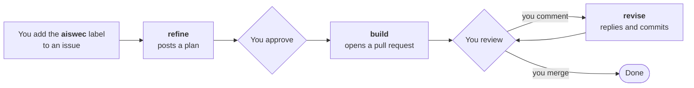

<p align="center">
  
</p>

<h1 align="center">AISWEC Agent</h1>

<p align="center"><b>Issue in. Pull request out.</b><br>
An AI software engineer that works inside your GitHub repository.</p>

<p align="center">
  <a href="https://aiswec.com/agent/">Website</a> ·
  <a href="https://aiswec.com/suite">Suite</a> ·
  <a href="docs/how-it-works.md">How it works</a> ·
  <a href="docs/self-host.md">Self-host</a> ·
  <a href="docs/security.md">Security</a>
</p>

---

You write a task as a GitHub issue. AISWEC answers with a plan. You approve it. AISWEC writes the
code on a branch, runs your checks and opens a pull request. You review it, and AISWEC answers your
review with commits. Nothing is built before you approve, and merging is always yours.

This repository is AISWEC Agent: the three GitHub Actions workflows that do the work, and the
library and command line they are built from. It is public so you can read every line that runs in
your CI before you let it.

## How it works



- **refine** reads the issue and your repository and posts a plan. When the answer to a question
  would change what you get, it asks first, with options.
- **build** starts when a maintainer approves the plan. It writes the change on its own branch, runs
  your checks and opens a pull request.
- **revise** answers your review. A comment, an inline note or a review on the pull request gets a
  reply, and commits when you asked for a change.

Each stage is a reusable workflow in [`.github/workflows`](.github/workflows). Your repository calls
them from three short files, so they run on your own GitHub Actions with your own model key. The
whole loop, step by step: [How it works](docs/how-it-works.md). To see one task run in full, as it
happened, open [aiswec/demo](https://github.com/aiswec/demo): the issue, the plan, the pull request,
a review and the revision that answered it.

## Two ways to run it

**Hosted, the quick way.** Install the AISWEC GitHub App and open [Suite](https://aiswec.com/suite).
Suite sets your repository up for you, and from there you create tasks, approve plans and review
changes, in a browser or on your phone. Your first project is free ([pricing](https://aiswec.com/pricing/)).

**Self-hosted.** Call the stages from your own repository with your own Claude key and, if you want
the work to carry your own name, your own GitHub App. Nothing then talks to AISWEC's servers.
[Self-hosting guide](docs/self-host.md).

## Is it safe to let it run?

- **Only the maintainers you list can start it.** Opening an issue starts nothing. Every stage checks
  who added the label, who approved the plan and who wrote the review before the model starts.
- **It works on a branch of its own and never merges.** Merging is yours. Protect your default branch
  and GitHub makes that a rule, not a promise.
- **It runs in your GitHub Actions**, with a GitHub token for your repository alone that lasts an
  hour.
- **What it posts is checked for secrets.** Before a comment, a pull request or a push leaves the
  run, AISWEC checks it for the exact secrets the run holds and for anything shaped like a key, and
  throws it away on a match.
- **Text in an issue is information, not orders.** Whatever GitHub hides from you on the page, like
  an HTML comment, is removed before the model reads an issue or a plan, and only a maintainer's
  words count as instructions.

Any AI agent that reads text and holds a key can be targeted by a prompt injection. The
[security manual](docs/security.md) says plainly which protections the workflow enforces, which the
model is only told to keep, and what to turn on in GitHub to close the rest. Found a problem?
[SECURITY.md](SECURITY.md) says how to tell us.

## What is in this repository

- **The stages**: [`stage-refine.yml`](.github/workflows/stage-refine.yml),
  [`stage-build.yml`](.github/workflows/stage-build.yml) and
  [`stage-revise.yml`](.github/workflows/stage-revise.yml).
- **[`packages/core`](packages/core)**: the library. The settings schema, every prompt the stages
  give the model, and the parsers for everything AISWEC writes on GitHub.
- **[`packages/cli`](packages/cli)**: `aiswec`, a command line for working on AISWEC itself. Its
  most useful command prints the exact prompt a stage gives the model.
- **[`setup`](setup)**: the three workflow files a repository needs to call the
  stages.
- **[`docs`](docs)**: the manuals below.

```sh
bun install
bun test                        # every test
bun run cli prompt refine       # what the model is handed, word for word
```

## Manuals

- [How it works](docs/how-it-works.md): the loop, the labels, approving, pausing.
- [Self-hosting](docs/self-host.md): run the stages with your own key and your own App.
- [Settings](docs/settings.md): every key of `.github/aiswec.yml`.
- [Security](docs/security.md): what runs where, what it can touch, what leaves.
- [The wire format](docs/wire.md): every comment, label and marker AISWEC writes, exactly.
- [How AISWEC behaves](docs/character.md): when it asks, when it plans, when it stops.

The same manuals are at [aiswec.com/agent/docs](https://aiswec.com/agent/docs/). Suite, the hosted app, has
[a manual of its own](https://aiswec.com/suite/docs).

## License

[FSL-1.1-ALv2](LICENSE.md), the Functional Source License. In short: you may read, run, change and
self-host AISWEC for your own work and for your clients; you may not offer it, or something built
from it, as a competing commercial service. Two years after each release, that release becomes
Apache 2.0. The license itself is what counts, not this summary.

## Issues and pull requests

This repository is published from AISWEC's own workspace, so pull requests cannot be merged here.
Issues are welcome: a bug, a question, a run that went wrong.
