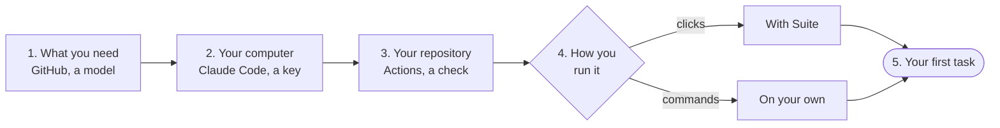

# Getting started

From nothing to AISWEC's first plan in your repository. Get three things ready, choose how to run
it, and give it a small task. It takes about ten minutes with Suite, and fifteen on your own.



## Two ways to run it

Both run the same three workflows in your repository's own GitHub Actions, on your own model key.
What differs is who sets them up, and where you work afterwards.

- **With Suite**, the hosted way. You install the AISWEC GitHub App and open
  [Suite](https://aiswec.com/suite), which sets the repository up for you. Then you create tasks,
  approve plans and review changes in a browser or on your phone. Your first project is free
  ([pricing](https://aiswec.com/pricing/)).
- **On your own.** You create your own GitHub App (or none), add your key and copy three files.
  Nothing talks to AISWEC's servers, and it costs nothing. You work on GitHub itself: issues,
  labels and comments.

Not sure? Start with Suite. Its *Setup* screen checks each step below for you.

## 1. What you need

- **A GitHub account and a repository.** With Suite you can also start with no repository: it
  makes one for you. You need admin access to the repository, since setting it up writes secrets.
  In an organization, installing an App can need an owner of the organization; GitHub sends them
  your request.
- **A model for AISWEC to run on**, one of:
  - **A Claude plan that includes Claude Code**: Pro, Max, Team or Enterprise. The free plan does
    not. Each run counts against your plan's limits, and AISWEC adds nothing on top.
  - **AISWEC credits**, with Suite: any model OpenRouter serves, paid as you go. You need no Claude
    account.
  - **Your own OpenRouter key**, when you run it on your own.

## 2. Get your computer ready

Nothing of AISWEC runs on your computer. You need it once, to make the key that lets AISWEC use
your Claude plan. On AISWEC credits, skip to step 3.

1. Install [Claude Code](https://code.claude.com/docs/en/setup). On macOS, Linux or WSL:

   ```sh
   curl -fsSL https://claude.ai/install.sh | bash
   ```

   On Windows, in PowerShell:

   ```powershell
   irm https://claude.ai/install.ps1 | iex
   ```

   Or with Homebrew: `brew install --cask claude-code`. Then open a new terminal and check that it
   answers:

   ```sh
   claude --version
   ```

2. Make a key:

   ```sh
   claude setup-token
   ```

   Your browser opens. Sign in with the Claude account whose plan should pay, and approve. The
   terminal prints a token that starts with `sk-ant-oat01-`. Copy it now, since nothing saves it.
   It lasts a year, and then you make a new one the same way.

3. **On your own only:** install the [GitHub CLI](https://cli.github.com) and sign in with
   `gh auth login`. The self-hosting guide's commands use it.

> [!TIP]
> The token is one long line, and a terminal that wraps it can break it on the way to the
> clipboard. A run with a broken token stops at "OAuth access token is invalid". Copy it from a
> wide window, or use the command in [Self-hosting](self-host.md#2-add-your-model-key) that cleans
> it.

## 3. Get your repository ready

AISWEC works in your repository the way your CI does, so it needs what your CI needs.

1. **GitHub Actions is on.** On GitHub, open the repository's *Settings, Actions, General*. If your
   organization limits which actions may run, allow the ones listed in
   [Self-hosting](self-host.md#if-your-organization-limits-actions).
2. **One check that passes today.** AISWEC runs your checks before every push, and opens nothing
   until they pass. Use the command you would run yourself, such as `npm test`, `bun test`,
   `pytest`, `go test ./...` or `cargo test`. Run it on your default branch first: a check that
   already fails there fails every build. Keep it to plain words, since a check with a quote, a
   `$`, a `;` or a `|` is left out. AISWEC works without any check, but then nothing tells you
   whether its code runs.
3. **A runtime it can install.** Node, bun and Python are installed from your settings, and Go and
   Rust are already on GitHub's runners. AISWEC starts nothing else, so a check that needs a
   database or another service has to start it on its own.
4. **Notes for AISWEC** (recommended). Before every plan, AISWEC reads your `README.md` and a
   `CLAUDE.md` at the root. Put in `CLAUDE.md` what a new engineer would ask: how to run the
   project, its conventions, what not to touch. If you keep a `CODE.md`, your own rules for how an
   AI model works with you, AISWEC reads it first and follows it on how to work and how to write.
5. **A protected default branch** (recommended). Require a pull request before merging, and leave
   *Allow GitHub Actions to create and approve pull requests* off (*Settings, Actions, General*).
   Then merging is yours by GitHub's rule, not only by AISWEC's promise. On GitHub's free plans
   these rules are enforced in public repositories only. More in
   [Security](security.md#make-it-stronger-in-your-repository).

## 4. Set it up

### With Suite

1. Open [aiswec.com/suite](https://aiswec.com/suite) and sign in with GitHub.
2. Install the AISWEC App on your account or organization. *New project* has the link. GitHub asks
   which repositories it may use: *All repositories* lets a new project work at once, while *Only
   select repositories* means adding each one.
3. Choose **New project**, then **Make a new one** (a repository from AISWEC's template, ready to
   run) or **Use one you have**.
4. Paste your Claude key where Suite asks for it: on *New project* for a new repository, on the
   project's *Setup* for one you have. *Setup* shows the command that makes one, with a *Copy*
   button. To run on credits instead, add them on *Credits*, turn them on for the project there,
   and choose *AISWEC credits* under *Engine* in the project's *Settings*.
5. On *Setup*, check the test command Suite found, or type yours, and press **Set up**. It writes
   the three workflow files, `.github/aiswec.yml` with you as its maintainer, the labels and the
   secrets, in one go.

*Setup* is a checklist, and each line says whose it is. When it says AISWEC is ready, go on to
your first task. Every screen from there on is in [Suite's manual](https://aiswec.com/suite/docs).

### On your own

[Self-hosting](self-host.md) has every command. In short:

1. Create a GitHub App of your own and give the repository its id and key as secrets, or use no
   App.
2. Add your key as the secret `CLAUDE_CODE_OAUTH_TOKEN`, or `OPENROUTER_API_KEY`.
3. Add `.github/aiswec.yml` with yourself as a maintainer, your check and your runtime.
4. Copy the three workflow files into `.github/workflows/`.
5. Create the six labels AISWEC moves an issue between.

## 5. Your first task

Start small and clear: one change, described as the result you want. For example, "Add a short
Contributing section to the README".

- **In Suite**, press **New task**, pick the project and write that sentence.
- **On GitHub**, open an issue with it and add the `aiswec` label.

Within a minute a comment says AISWEC is reading it, and a few minutes later the plan arrives.
Read it, approve it, and review the pull request it opens. [How it works](how-it-works.md) takes
you through each step.

## If nothing happens

Open the repository's **Actions** tab. Each run says in its log why it started, or why it skipped.
The usual causes:

- **No run at all.** Actions is off, or the three workflow files are not on your default branch.
  GitHub runs an issue's workflows from there.
- **The run skipped.** The person who added the label, approved or reviewed is not in
  `maintainers` in `.github/aiswec.yml`.
- **"OAuth access token is invalid".** The key was cut on its way to the clipboard, or its year is
  up. Make a new one with `claude setup-token`.
- **Every build fails its checks.** The check fails on your default branch too. Fix it there, or
  change it in your settings.

With Suite, the project's *Setup* says what is left, and *Check again* reads GitHub again.
