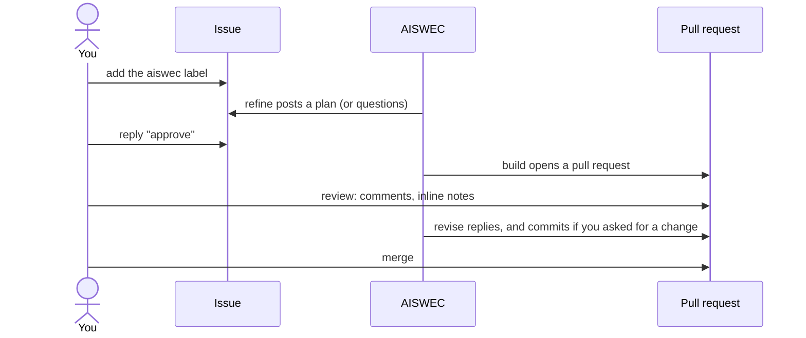

# How it works

AISWEC does three jobs, and you do three. It plans, builds and answers review. You assign the
task, approve the plan and accept the changes. Everything happens on GitHub: a task is an issue, a
plan is a comment on it, and the changes are a pull request.

Each of AISWEC's jobs is a GitHub Actions workflow in this repository, called a **stage**:

- **refine** turns an issue into a plan.
- **build** turns an approved plan into a pull request.
- **revise** turns your review into a reply and new commits.

Your repository holds three short workflow files that call the stages, and a settings file,
`.github/aiswec.yml`, that says who the maintainers are and how to check the code. Setting those up
is in [Self-hosting](self-host.md), or Suite does it for you.

## 1. Give AISWEC a task

Open an issue and describe what you want, then add the **`aiswec`** label. That label is the
assignment: opening an issue alone starts nothing.

- Only a **maintainer** can assign a task. Maintainers are the GitHub accounts listed under
  `maintainers` in `.github/aiswec.yml`. Anyone may have written the issue; what counts is who
  added the label.
- Within seconds a comment says AISWEC is reading, with a link to the run. It goes away when the
  answer is posted, usually a few minutes later.
- Write it as you would for a colleague: the result you want, not the code. Keep one task to one
  change. A big ask comes back as a big plan.

## 2. Read the plan

AISWEC reads the issue, your repository and, where a library or a service is involved, that
vendor's own documentation for the version you use. Then it answers in one of four ways.

**A plan.** Most of the time. It opens with a short note in plain words, then:

- **Manual todos**: what only you can do, such as adding a secret or changing a store setting. Left
  out when there is nothing.
- **At a glance**: the size, how many files, and whether a contract changes.
- **Problem**, **Proposed approach** (numbered, tests last) and **Affected files**.
- **What the docs say**, when it read a vendor's guide, with the pages it read.
- **Code sketch** and **Flow**, when a shape changes or something moves.
- **Acceptance criteria**, and **Try it**: up to three steps to check the result yourself.

**Questions.** When your answer would change what you get, AISWEC asks before it plans: up to three
questions, each with two to four options and the one it would pick marked as recommended. Answer
with the letters ("1: a, 2: c") or in your own words, then run refine again (see
[Run a stage again](#7-run-a-stage-again)). In Suite you pick the options and press *Send answers*.

**A blocker.** When no change in this repository can do the job, or it needs a credential only a
person holds, AISWEC says so and lists what a person has to do. It does not stop at "this is
infrastructure": a workflow file or a config file is still a file it can write.

**An answer.** When a maintainer only asked a question about a plan, AISWEC answers it and the plan
stands.

To change a plan or ask about it, reply on the issue, then run refine again: on GitHub, refine reads
replies only when it runs (Suite runs it for you when you send one). It plans again from everything
a maintainer has said. AISWEC reads other people's comments as information, never as instructions.

## 3. Do your manual todos

Some changes need a step only you can take: a token to create, a secret to add, a setting in a
console. The plan lists them under **Manual todos**, one line each, with where to go.

Do them before you approve, so the build can use them. Suite keeps the list as a checklist and
waits for every tick before it lets you approve. On plain GitHub nothing checks them for you.

A step that belongs in another repository starts with "Follow-up in" and the repository's name. It
never holds the plan.

## 4. Approve

Reply to the plan with a comment whose first line starts with one of these words:

`approve` · `approved` · `lgtm` · `ship it` · `go ahead`

Or add the **`aiswec:ready-to-build`** label. Only a maintainer's approval counts.

- AISWEC builds the plan **exactly as posted**. Anything you write after the keyword is not read,
  so ask for a new plan first if you want something changed.
- A plan posted after your approval replaces it, and needs its own approval.
- If an earlier pull request for the same issue is still open, the build waits until you close or
  merge it.

## 5. The build

The build writes the change on a branch of its own, named after the issue, such as
`aiswec/issue-42-add-dark-mode`. It does not push to your default branch;
[protect that branch](security.md#make-it-stronger-in-your-repository) and GitHub makes it a rule.

- It runs your **checks** (the `gates` in `.github/aiswec.yml`, like `bun run test`) before it
  pushes, and when one fails it fixes the code, not the test. Your own CI runs on the push as usual.
- It opens a pull request that says what changed and why, which checks passed, and how to try it.
  The pull request closes the issue when it is merged.
- If the checks still fail after three tries, it opens a **draft** pull request instead, with the
  failing output and what it thinks is wrong.

## 6. Review

Review the pull request as you would a colleague's: a comment, an inline note on a line, or a whole
review. AISWEC answers each round with one reply.

- A question gets an answer.
- A request for a change gets new commits on the same branch, after your checks pass again. It adds
  to the branch rather than rewriting it, and never opens a second pull request.
- A decision that is yours to make gets questions in the reply, and no code.

Only maintainers' words are acted on. A request for new work belongs in a new task, with its own
plan. When you are happy, merge. Merging is always yours: AISWEC has no step that merges.

## 7. Run a stage again

Every stage can be started by hand from your repository's **Actions** tab: choose the workflow, press
*Run workflow*, and give it the issue or pull request number.

- **refine**, with the issue number: plans again from everything a maintainer has said, including
  your answers to its questions.
- **build**, with the issue number: tries the build again, for example after a failure.
- **revise**, with the pull request number: answers the review again.

Suite has a button for each of these.

## 8. Pause or stop

- **Pause** with the **`aiswec:hold`** label on the issue or the pull request. Build and revise skip
  it until you remove the label.
- **Stop** by removing the **`aiswec`** label. Nothing new starts. A run already going finishes.

## The labels

- `aiswec`: the task is AISWEC's. Added by a maintainer.
- `aiswec:refined`: a plan is waiting for approval.
- `aiswec:ready-to-build`: a maintainer's approval, as a label.
- `aiswec:pr-open`: the pull request is ready for review.
- `aiswec:needs-human`: AISWEC is waiting for a person (questions, a blocker, or a failure).
- `aiswec:hold`: paused.

An issue carries at most one of `refined`, `ready-to-build`, `pr-open` and `needs-human` at a time.
The prefix comes from your stubs' `namespace`, `aiswec` unless you changed it.

## Previews

If you set a preview command, each pull request also gets a link to the change as a running site,
and for Expo apps a QR code to open it on a phone. See [Settings](settings.md#previews).

## Going further

- [Settings](settings.md): every key of `.github/aiswec.yml`.
- [The wire format](wire.md): every comment and marker exactly as AISWEC writes it.
- [How AISWEC behaves](character.md): its rules for asking, planning and stopping.
