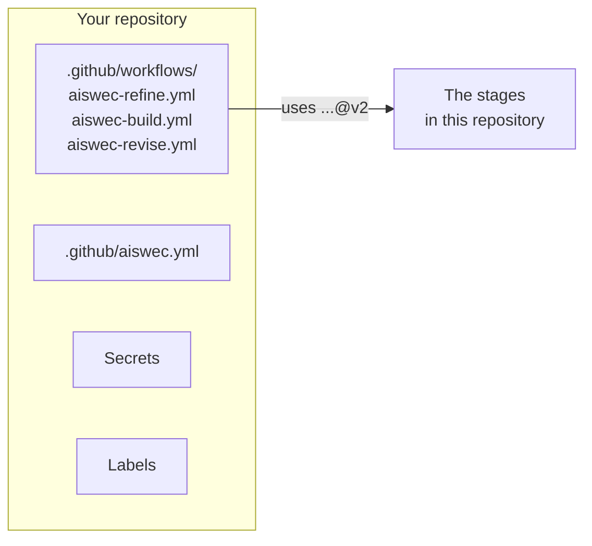

# Self-hosting

Run AISWEC in your own repository with your own model key, without Suite and without AISWEC's
servers. It takes about fifteen minutes. If you would rather click than copy, the hosted way does
all of this for you: install the App and open [Suite](https://aiswec.com/suite).



You need:

- A GitHub repository with Actions turned on.
- A Claude subscription that includes Claude Code, or an OpenRouter account.
- The [GitHub CLI](https://cli.github.com) (`gh`), signed in, for the commands below. Everything
  here can also be done on github.com.

In the commands, replace `OWNER/REPO` with your repository.

## 1. Choose who AISWEC works as

Every comment, push and pull request is made by some GitHub identity. Pick one:

- **Your own GitHub App** (recommended). Everything shows as your App, for example `acme-ai[bot]`.
  Nothing talks to AISWEC.
- **No App.** Comments show as `github-actions[bot]`, and pushes and pull requests as `claude[bot]`,
  through the Claude GitHub App. Quicker to set up. It cannot change workflow files, so a task that
  needs one will stop there.

### Your own GitHub App

1. On GitHub, open **Settings, Developer settings, GitHub Apps, New GitHub App**. For an
   organization, use the organization's settings instead.
2. Give it a name and a homepage URL (your repository's will do). Under **Webhook**, clear
   **Active**: AISWEC needs no webhook.
3. Under **Repository permissions**, set:
   - **Actions**: Read and write
   - **Contents**: Read and write
   - **Issues**: Read and write
   - **Pull requests**: Read and write
   - **Workflows**: Read and write
   - **Metadata**: Read-only (set for you)
4. Under **Where can this GitHub App be installed?**, choose **Only on this account**, and create
   it.
5. Note the **App ID** at the top of the App's page. Under **Private keys**, generate a key; a
   `.pem` file downloads.
6. Choose **Install App** and install it on your repository.
7. Give the repository both values:

   ```sh
   gh secret set AISWEC_APP_ID -R OWNER/REPO --body "123456"
   gh secret set AISWEC_APP_PRIVATE_KEY -R OWNER/REPO < your-app.private-key.pem
   ```

> [!IMPORTANT]
> Set both secrets, or neither. With an App ID and no key, a run asks aiswec.com for a token
> instead, which works only for AISWEC's own App, and the run fails.

### No App

Install the [Claude GitHub App](https://github.com/apps/claude) on your repository. Keep the line
`id-token: write` in the workflow files of step 4: the run uses it to get the Claude App's token.

## 2. Add your model key

**With a Claude subscription:** on your own computer, with
[Claude Code](https://code.claude.com/docs) installed, run:

```sh
claude setup-token
```

Copy the token it prints, then:

```sh
gh secret set CLAUDE_CODE_OAUTH_TOKEN -R OWNER/REPO
```

`gh` asks for the value, so the token never lands in your shell's history.

The token is one long line, and a terminal that wraps it can break it on the way to the clipboard.
A run that stops at "OAuth access token is invalid" got part of the token, and one that says no
`claude_code_oauth_token` reaches the stage got nothing. On macOS, this sets the secret from the
clipboard with every line break taken out, after checking it looks like a token:

```sh
T=$(pbpaste | tr -d '[:space:]'); [[ $T == sk-ant-oat01-* ]] && printf %s "$T" | gh secret set CLAUDE_CODE_OAUTH_TOKEN -R OWNER/REPO && echo "set, ${#T} characters"; unset T
```

**With OpenRouter:** create a key at [openrouter.ai](https://openrouter.ai), ideally with a spending
limit, then:

```sh
gh secret set OPENROUTER_API_KEY -R OWNER/REPO
```

and set `provider: openrouter` and a `model` in the next step. See [Settings](settings.md#provider).

## 3. Add the settings file

Create `.github/aiswec.yml` on your default branch. The smallest one that works:

```yaml
maintainers: [your-github-login]
gates:
  - npm run test
runtime:
  setup: node
  version: "22"
  install: npm ci
```

- `maintainers` are the people AISWEC takes instructions from. Only they can assign, approve and
  review.
- `gates` are the commands that say a change works. AISWEC runs them before it pushes, each as
  written, so keep each one plain words (see [Settings](settings.md#gates)).
- `runtime` is what to install first. For a bun project, use `setup: bun` and leave `version` out;
  for Python, `setup: python` with an `install` such as `pip install -r requirements.txt pytest`.

Every key is in [Settings](settings.md).

## 4. Add the three workflow files

Copy the three files in [`setup`](../setup) into your repository's
`.github/workflows/`:

```sh
mkdir -p .github/workflows
for stage in refine build revise; do
  curl -fsSL -o .github/workflows/aiswec-$stage.yml \
    https://raw.githubusercontent.com/aiswec/core/main/setup/aiswec-$stage.yml
done
```

They hold only the events to listen to, the permissions, and which stage to call. If your default
branch is not `main`, uncomment `base_branch` in `aiswec-build.yml` and name it.

Commit them and the settings file to your default branch.

## 5. Create the labels

AISWEC moves an issue between these labels, and does not create them:

```sh
R=OWNER/REPO
gh label create aiswec                -R $R --color 1d1b3a --description "Assigned to aiswec, which takes this issue"
gh label create aiswec:refined        -R $R --color c5def5 --description "A spec has been posted for this issue"
gh label create aiswec:ready-to-build -R $R --color 0052cc --description "Cleared to run the build stage"
gh label create aiswec:pr-open        -R $R --color 5319e7 --description "A pull request is open for this issue"
gh label create aiswec:needs-human    -R $R --color b60205 --description "Automation stopped and needs a maintainer"
gh label create aiswec:hold           -R $R --color d93f0b --description "Operator brake: automation will not advance this issue"
```

## 6. Try it

Open an issue with a small, clear task, such as "Add a short Contributing section to the README",
and add the `aiswec` label. Within a minute a comment says AISWEC is reading it, and a few minutes
later the plan arrives. From there, [How it works](how-it-works.md) takes over.

If nothing happens, open the **Actions** tab. Each run says in its log why it started, or why it
skipped.

## Staying current

Your workflow files call the stages at `@v2`, which moves with every release, so fixes reach you
without a commit. To review every change before it runs in your repository, replace `@v2` with a
commit SHA from this repository and move it when you are ready. A change that would need you to
edit your workflow files comes as `@v3`, never inside `@v2`.

## If your organization limits actions

Allow this repository's workflows and these actions:

- `actions/checkout@v4`
- `actions/create-github-app-token@v2`
- `actions/setup-node@v4`
- `actions/upload-artifact@v4`
- `anthropics/claude-code-action@v1`
- `oven-sh/setup-bun@v2`

## What you do not get without Suite

- **Buttons.** Approving, answering questions and running a stage again are comments and the
  Actions tab instead.
- **Manual todos as a checklist.** On GitHub, nothing stops an approval while a todo is open.
- **Web previews.** The built site is kept as a workflow artifact you can download, but the link in
  the pull request is served only through Suite. Phone previews work with your own `EXPO_TOKEN`.
